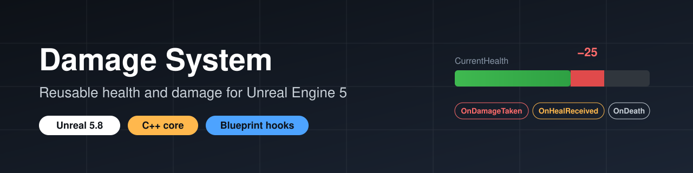
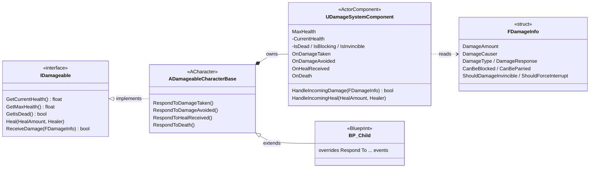
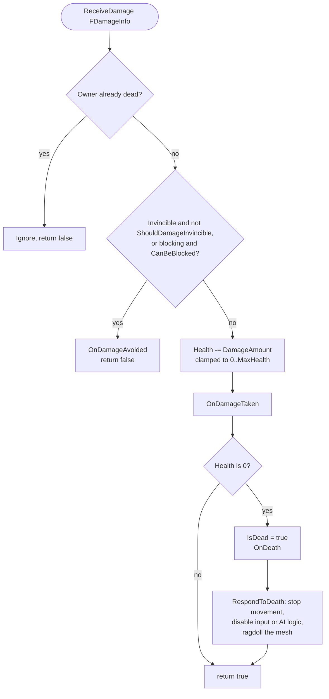

<p align="center">
  
</p>

<p align="center">
  <a href="https://www.ibrahimenescolak.com"><b>Portfolio</b></a> ·
  <a href="https://www.linkedin.com/in/ibrahim-enes-%C3%A7olak">LinkedIn</a> ·
  <a href="https://qpayk.itch.io">itch.io</a>
</p>

# DamageSystemTemplate

A small health and damage module for Unreal Engine 5, written in C++ with Blueprint extension points.

I built it as a learning project to understand how a damage system can be structured in UE5: an interface, a reusable component, and events that other systems can react to. It handles health, healing, blocking, invincibility and death. It does **not** include attacks, weapons or hit detection (see [Not included](#not-included)).

## What's in it

All C++ lives in `Source/DamageSystemTemplate/DamageSystem/`.

| File | What it does |
|---|---|
| `DamageSystemTypes.h` | `FDamageInfo` struct (amount, causer, damage type, damage response, block/parry/invincibility flags) and the `EDamageType` / `EDamageResponse` enums |
| `Damageable.h` | `IDamageable` interface: `GetCurrentHealth`, `GetMaxHealth`, `GetIsDead`, `Heal`, `ReceiveDamage` (all `BlueprintNativeEvent`) |
| `DamageSystemComponent` | `UActorComponent` that holds health and processes damage and healing |
| `DamageableCharacterBase` | `ACharacter` that implements `IDamageable`, owns a `DamageSystemComponent` and exposes overridable response events |

### How the classes fit together



## How it works

`UDamageSystemComponent::HandleIncomingDamage` does this:

1. If the owner is already dead, the damage is ignored.
2. If the owner is invincible (and the damage doesn't have `ShouldDamageInvincible`), or is blocking (and the damage has `CanBeBlocked`), `OnDamageAvoided` fires and no health is lost.
3. Otherwise health is reduced (clamped between 0 and `MaxHealth`) and `OnDamageTaken` fires.
4. At 0 health the owner is marked dead and `OnDeath` fires. Further damage and healing are ignored.



Healing works the same way: it is clamped to `MaxHealth`, fires `OnHealReceived`, and is ignored if the owner is dead.

Health starts at `MaxHealth` in `BeginPlay`, so changing `MaxHealth` in the editor or in a Blueprint child is enough.

`ADamageableCharacterBase` binds to the component's delegates and forwards them to four `BlueprintNativeEvent`s you can override in a Blueprint child:

- `RespondToDamageTaken`
- `RespondToDamageAvoided`
- `RespondToHealReceived`
- `RespondToDeath`

The default `RespondToDeath` stops movement, disables player input (or stops the AI logic for AI controllers), turns off the capsule collision and enables ragdoll physics on the mesh.

Neither the component nor the character base ticks; everything is event driven.

## Usage

**Dealing damage from C++:**

```cpp
#include "Damageable.h"

if (TargetActor && TargetActor->Implements<UDamageable>())
{
    FDamageInfo Info;
    Info.DamageAmount = 25.f;
    Info.DamageCauser = this;
    Info.DamageType   = EDamageType::Physical;

    const bool bDamageApplied = IDamageable::Execute_ReceiveDamage(TargetActor, Info);
}
```

`ReceiveDamage` returns `true` if the damage was applied and `false` if it was avoided or the target was already dead.

**From Blueprint:** call `Receive Damage` on any actor that implements the `Damageable` interface and fill in a `DamageInfo` struct.

**Reacting to events:** either override the `Respond To ...` events in a child of `DamageableCharacterBase`, or bind to the component's delegates (`OnDamageTaken`, `OnDamageAvoided`, `OnHealReceived`, `OnDeath`) from UI, audio or animation Blueprints.

**Using it on a non-character actor:** add a `DamageSystemComponent` to the actor, implement `IDamageable` and forward the calls to the component, the same way `ADamageableCharacterBase` does.

## Notes on `FDamageInfo`

`DamageType`, `DamageResponse`, `CanBeParried` and `ShouldForceInterrupt` are data fields for gameplay logic. The component doesn't read them itself; they are there so Blueprints (or your own C++) can decide how to react, for example which hit reaction to play. Parrying is not implemented.

## Not included

- Attacks, weapons, hitboxes or any other way of dealing damage
- Health bars or other UI
- Network replication (health isn't replicated and `ReceiveDamage` doesn't check authority)
- Save/load
- Automated tests

## Setup

1. Install [Git LFS](https://git-lfs.com/) before cloning, because the project's binary assets are stored with it.
2. Clone the repository.
3. Right-click `DamageSystemTemplate.uproject` and generate the Visual Studio project files.
4. Build and open the project in Unreal Engine 5.8.

## Project structure

```
Config/     project settings
Content/    Unreal assets (based on the Third Person template and its animation packs)
Source/     C++ code
```
